# M1 UI baselines

Captured 2026-11-24. Regenerate with `node scripts/m1/capture-ui-baselines.mjs` (set KESSHO_BASE_URL to reuse a running dev server).

### Global, default view, 390px

Global page, default view, 390px wide.

### Synth, simple view, 390px

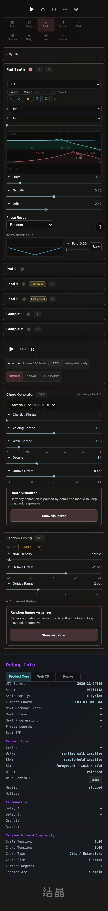

Synth page, simple view, 390px wide.

### Synth, detail view, 390px

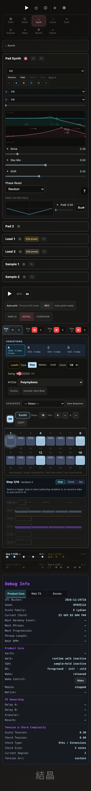

Synth page, detail view, 390px wide.

### Synth, overview view, 390px

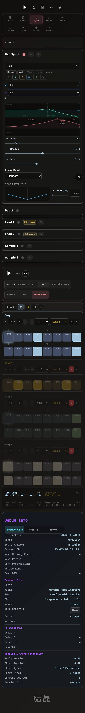

Synth page, overview view, 390px wide.

### Drums, overview view, 390px

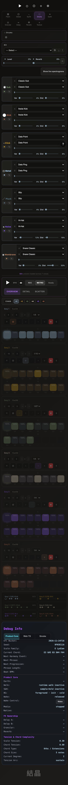

Drums page, overview view, 390px wide.

### Drums, detail view, 390px

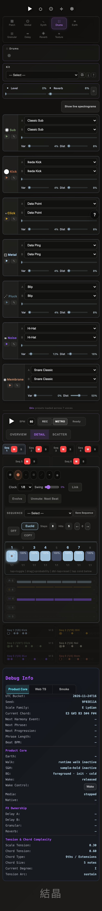

Drums page, detail view, 390px wide.

### Drums, scatter view, 390px

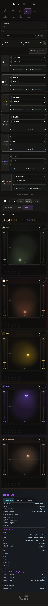

Drums page, scatter view, 390px wide.

### Global, default view, 1280px

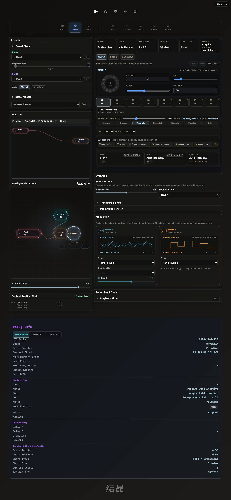

Global page, default view, 1280px wide.

### Synth, simple view, 1280px

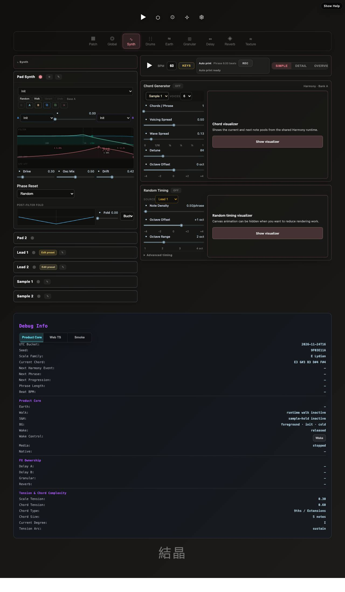

Synth page, simple view, 1280px wide.

### Synth, detail view, 1280px

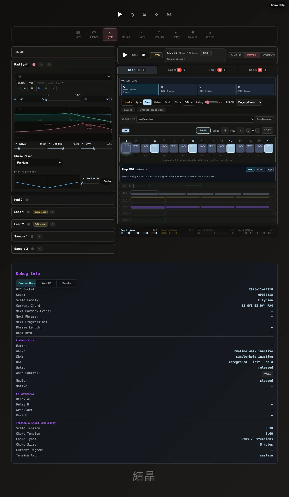

Synth page, detail view, 1280px wide.

### Synth, overview view, 1280px

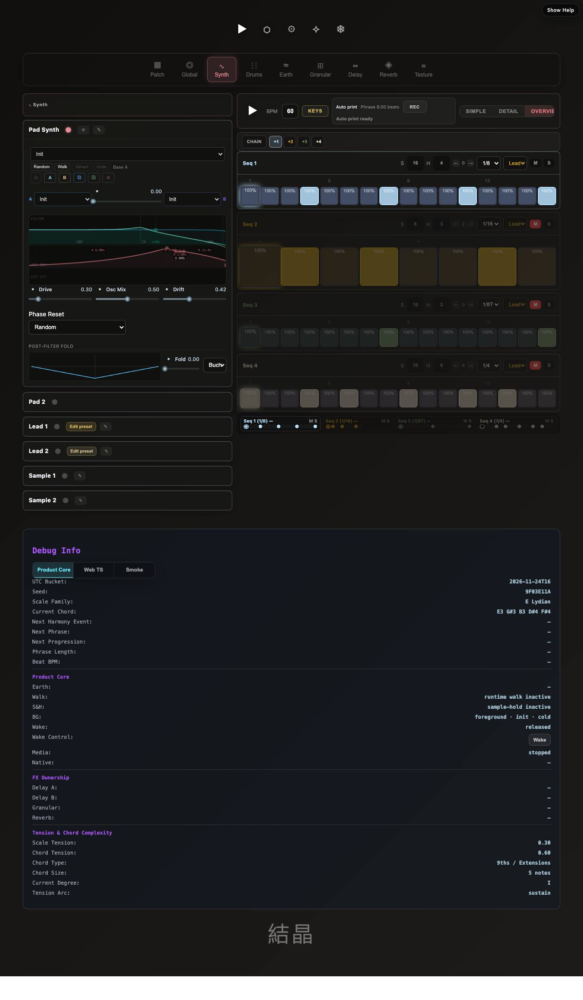

Synth page, overview view, 1280px wide.

### Drums, overview view, 1280px

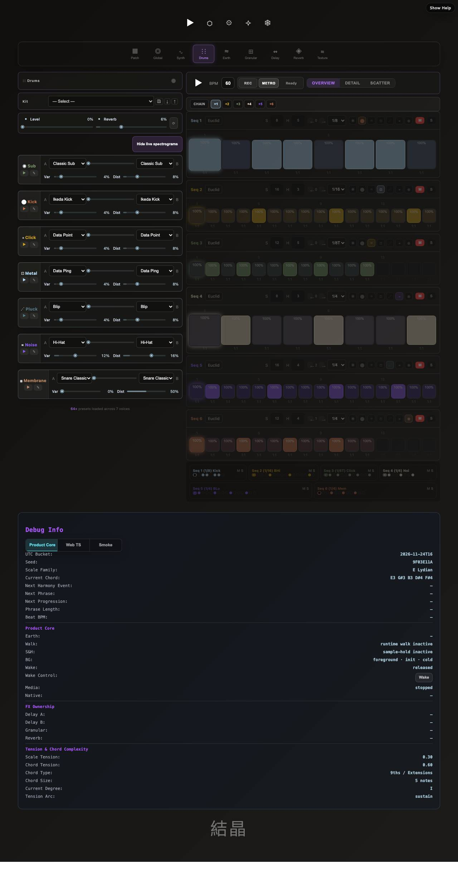

Drums page, overview view, 1280px wide.

### Drums, detail view, 1280px

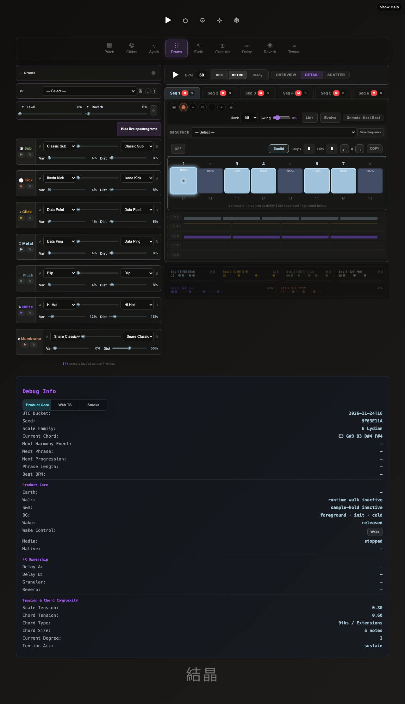

Drums page, detail view, 1280px wide.

### Drums, scatter view, 1280px

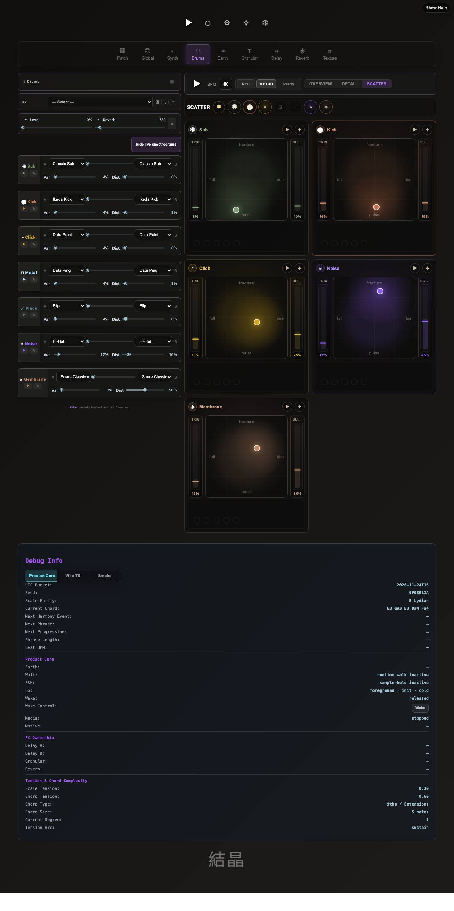

Drums page, scatter view, 1280px wide.
